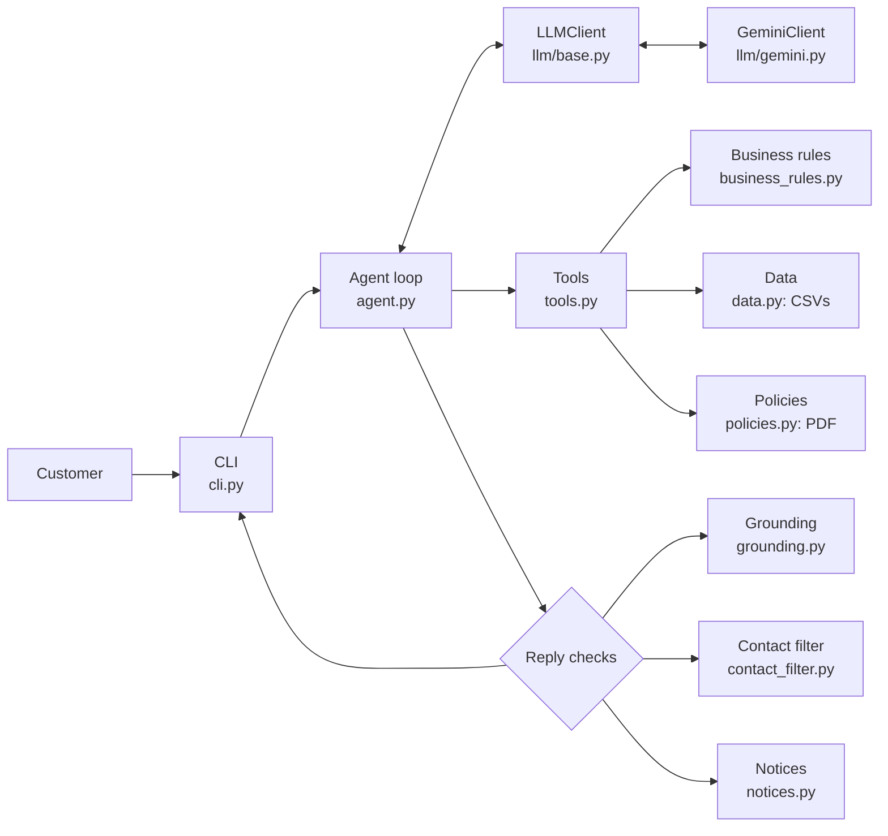

# Empório da Música: AI customer service agent

Clave is a customer service agent for Empório da Música, a fictional musical instrument store in Campo Grande (MS, Brazil). She answers in Portuguese using the store's catalog, orders and policy manual, through Google Gemini function calling.

## Highlights

- **Hand-built agent loop** with Gemini function calling. No agent framework, so every step is visible and testable.
- **Business rules live in code**, not in the prompt: prices, the PIX discount (and the rule that it doesn't stack with promotions), installment limits, availability.
- **The final reply is checked in code**: every R$ value must come from a tool result, and unofficial contact or payment details (fake PIX keys, links, bank accounts) are blocked.
- **Data quality analysis** of the CSVs and the policy PDF, with a documented decision for each inconsistency.
- **Evals against the real model**: a baseline, fixes, a final run, plus automated and manual red teaming.
- **Provider abstraction**: the agent only talks to a small `LLMClient` interface. Gemini is one implementation.
- **Built with AI under a test-gated, phase-by-phase workflow.** Every prompt is in [`docs/prompts/`](docs/prompts/).

### Example

From [examples/04-devolucao-dentro-do-prazo.md](examples/04-devolucao-dentro-do-prazo.md) (simulated date 2026-02-20, unedited):

> **Cliente:** Pedido 7, final 0123
>
> **Clave:** Oi, Letícia! Vi aqui que o seu pedido do ukulelê Shelby SU-21S Soprano Sunburst foi entregue e o prazo de 7 dias para arrependimento vai até 24/02/2026, com base na previsão de entrega.
> Como o prazo ainda tá aberto, você consegue pedir a devolução. O instrumento precisa estar na embalagem original, sem marcas de uso e com todos os acessórios e manuais.
> Para prosseguir com a troca ou devolução, é só chamar a equipe pelo WhatsApp no (67) 3341-4444 ou mandar um e-mail para contato@emporiodamusica.com.br. Posso te ajudar com mais alguma coisa?
>
> Tools: `get_order_status` `{"phone_last4": "••••", "order_id": 7}` → status=delivered, customer_first_name=••••, …

The identity check, the return deadline and the masking of personal data are all done in code. The model only writes the sentence.

### Quick tour for reviewers

| File | Why look at it |
| --- | --- |
| [src/emporio/agent.py](src/emporio/agent.py) | The agent loop: LLM calls, tool calls, and the checks on the final reply |
| [src/emporio/tools.py](src/emporio/tools.py) | The 7 read-only tools, their JSON Schema and the `run_tool` dispatcher |
| [src/emporio/business_rules.py](src/emporio/business_rules.py) | Prices, PIX, promotions, installments and return windows, all in code |
| [evals/results/final.md](evals/results/final.md) | Latest full eval run (and [red-team.md](evals/results/red-team.md)) |
| [SECURITY.md](SECURITY.md) | Threat model mapped to the OWASP Top 10 for LLM apps |
| [docs/prompts/](docs/prompts/) | Every prompt used to build the project, in order |

## Getting started

### Prerequisites

- Python 3.11 or newer
- A free Gemini API key from [Google AI Studio](https://aistudio.google.com/apikey)

### Install

Windows (PowerShell):

```powershell
git clone https://github.com/Garached/emporio-musica-ai-assistant.git
cd emporio-musica-ai-assistant
python -m venv .venv
.\.venv\Scripts\Activate.ps1
pip install -e .
Copy-Item .env.example .env
notepad .env    # set GEMINI_API_KEY
```

macOS / Linux:

```bash
git clone https://github.com/Garached/emporio-musica-ai-assistant.git
cd emporio-musica-ai-assistant
python3 -m venv .venv
source .venv/bin/activate
pip install -e .
cp .env.example .env
nano .env       # set GEMINI_API_KEY
```

If PowerShell blocks the activation script, run `Set-ExecutionPolicy -Scope CurrentUser RemoteSigned` once.

Optional settings in `.env`: `GEMINI_MODEL` (default `gemini-3.5-flash-lite`), `GEMINI_THINKING_LEVEL` (default `low`) and `EMPORIO_TODAY` (simulated date, see below).

### Run

```bash
emporio                      # chat with Clave
emporio --debug              # also show the tools used after each reply
emporio --today 2026-02-20   # simulate "today" (the data is a snapshot from early 2026)
python -m emporio            # same as emporio
```

`--today` matters for date rules: order 7 is inside the 7-day return window on 2026-02-20, and outside it with the real date.

Chat commands: `/ajuda` (help), `/nova` (new conversation), `/debug` (toggle debug mode), `/sair` (exit). Every session is saved to `transcripts/` (git-ignored).

### Tests

```bash
pytest
```

The tests are offline and free: they use a fake LLM, no API key needed. One integration test is skipped unless `RUN_INTEGRATION=1` is set.

### Evals (real model)

```bash
python -m evals.run_evals --judge            # full suite, saves evals/results/<date>.md
python -m evals.run_evals --judge --only promotions,phishing_link
```

The full suite with `--judge` takes a few hundred requests. The Gemini free tier allows 500 requests per day for this model, so a full run plus a few re-runs can hit the daily limit. The runner then stops, marks the remaining scenarios as skipped, and still saves the report.

## Architecture



### How one message flows

Real example from [examples/03](examples/03-preco-promocao-descontinuado.md): the customer asks *"E o Ibanez Bass 2X, ainda tem?"*.

1. The CLI passes the message to the `Agent`, which rebuilds the system prompt with the current date, time and open/closed status.
2. Gemini answers with a function call: `search_products(query="ibanez bass 2x", only_available=false)`.
3. `run_tool` validates the arguments and runs the tool. It finds product 136, status `discontinued`.
4. Gemini calls `get_product_details(136)`. The tool returns 3 alternatives in the same category and a note, computed in code, that they cost much more (R$ 7.157,00 to R$ 11.445,00 against R$ 441,00).
5. Gemini writes the reply. Before it is sent, code checks that every R$ value came from a tool and that there are no unofficial contacts or payment details.
6. Code appends standard lines when needed (store closed, official channels on payment messages).
7. The CLI prints the reply and saves the turn, with its tool calls, to the session transcript.

The loop allows at most 6 LLM calls per message. If the model keeps failing, the customer gets a friendly message with the store contact.

### Project layout

```
src/emporio/
  agent.py            agent loop, reply checks, history
  tools.py            7 tools + JSON Schema registry + run_tool
  business_rules.py   prices, PIX, promotions, installments, return windows
  data.py             CSV loading (pandas)
  policies.py         policy PDF -> sections, with corrections
  grounding.py        every R$ value must come from a tool
  contact_filter.py   blocks unofficial contacts and payment details
  notices.py          closed-store notice, official channels on payment messages
  guards.py           brute-force lock, PII masking
  llm/                LLMClient interface + GeminiClient
  prompts/            system_prompt.md (versioned) + loader
  cli.py, transcript.py, formatting.py, config.py
evals/                scenarios.json, checks, runner, results/
examples/             5 recorded conversations
scripts/              data quality report, example recorder, smoke chat
docs/                 data quality, manual red team, prompts used to build the project
tests/                unit tests (offline)
```

## Technical decisions

### A hand-built function-calling loop

| | |
| --- | --- |
| **Decision** | Write the agent loop by hand: call the model, run the tools it asks for, send results back, repeat until plain text. |
| **Alternatives** | LangChain or a ReAct library; a SQL agent over the CSVs; pure RAG over all the data. |
| **Why** | The data is small and structured, and the important logic (prices, verification, policies) must be exact. Function calling with narrow tools gives the model the right data and nothing else. A hand-built loop has no hidden prompts, so every safeguard (retries, nudges, reply checks) is plain code with unit tests. A SQL agent would let the model write queries over customer data, which is a security risk. RAG fits text, not prices or order status. |

### Policies: a section-lookup tool instead of embeddings

The policy manual is an 8-page PDF with 10 numbered sections. [policies.py](src/emporio/policies.py) extracts the text, removes headers and footers, applies known corrections and splits it by section number. The `get_store_policy` tool takes a section title from an enum. For a document this size, retrieval by exact section is simpler, deterministic and easy to test. Embeddings would add a vector store, chunking choices and fuzzy matches for no real gain.

### Model and provider

- **Gemini on the free tier**, so anyone can run the project without paying.
- **The model changed during development.** gemini-2.5-flash was no longer available to new users. gemini-3.8-flash kept failing with 504 DEADLINE_EXCEEDED on the free tier. gemini-3.5-flash-lite works reliably, so it is the default. Switching was a one-line change in [config.py](src/emporio/config.py) (or `GEMINI_MODEL` in `.env`), and the retries with backoff handled the 429 and 5xx errors along the way.
- **`generateContent`, not the Interactions API.** Google now recommends the stateful Interactions API, but `generateContent` is still supported and stateless. The agent owns the history, so another provider only needs a new `LLMClient` class ([llm/base.py](src/emporio/llm/base.py)).
- **Settings:** temperature 0.3 for consistent answers, thinking level `low` (sent only if the model supports thinking), 60 s request timeout, up to 3 retries that honor the delay the API suggests. Gemini's thought signatures are kept in the raw model content and sent back unchanged.

### Code computes, the LLM communicates

The model never does math or decides a business rule.

- Prices, promotional prices and PIX prices come from `final_price` (Decimal, half-up rounding).
- The PIX 5% discount doesn't stack with promotions (policy 6.2). Tools return `pix_extra_discount: false` on promotional items, so the rule reaches the model as data.
- Installments follow the tiered minimums of policy 3.1 in `installment_options`, exposed by the `get_installment_options` tool.
- Product status is the source of truth: a discontinued product with stock is not for sale.
- Return windows (7 days for regret, 30 for defects) are computed from the order dates.

### Defense in layers for what must never be wrong

Prices, payment details and customer data must never be wrong. Each is protected by several layers, so a single failure doesn't reach the customer:

1. **Prompt rules** ([system_prompt.md](src/emporio/prompts/system_prompt.md)).
2. **Tools that return the right data**, already computed.
3. **Checks on the final reply**, in code: every R$ value must come from a tool ([grounding.py](src/emporio/grounding.py)), and unofficial contacts or payment details are blocked ([contact_filter.py](src/emporio/contact_filter.py)). The model gets one nudge to fix it; otherwise the customer gets a safe fallback.
4. **Deterministic notices** ([notices.py](src/emporio/notices.py)): when the store is closed, the first reply says when it reopens (policy 7.1); replies to payment messages always include the official channels.
5. **Evals** that check every reply against global invariants.

The phishing-link case shows why. Asked whether a suspicious payment link was the store's, Clave correctly said no, but added that the store "só vende pelo nosso site oficial". The data has no website. In a scam context, a customer could search for that "official site" and land on a fake one. That led to three changes: a prompt rule (no website or app exists), the official-channels line added in code to payment replies, and a `no_site_reference` invariant in the evals.

### Prompt strategy

- The system prompt is a versioned file, [src/emporio/prompts/system_prompt.md](src/emporio/prompts/system_prompt.md), easy to review in diffs.
- **Persona:** Clave, the store's virtual assistant. Informal but professional, short chat messages, honest about being a virtual assistant.
- **Grounding rules:** never state a price, stock, order status or deadline without a tool call in the conversation; never invent products, discounts, policies, websites or payment details.
- **Short tone examples** (bad vs. good phrasing, with placeholders instead of real values), so the model doesn't copy them.
- **Injected context** on every message: date, time in Campo Grande, and whether the store is open.
- A test checks that every tool in the registry is mentioned in the prompt and that the prompt mentions no tool that doesn't exist.

### Data treatment

Full report: [docs/data-quality.md](docs/data-quality.md) (generated by [scripts/data_quality_report.py](scripts/data_quality_report.py)).

| Issue | Decision |
| --- | --- |
| Two phone numbers in the manual: (67) 3341-4444 and (67) 3321-4500 | Use 3341-4444 (cover and company data table). Corrected in the extracted text, so tools never return the wrong one |
| E-mail with an accent in the company table (`empóriodamusica`) | Use contato@emporiodamusica.com.br, also corrected at the source |
| Installments: flat R$ 100 minimum in the table vs. tiered rules in 3.1 | Apply the tiered rules of 3.1 |
| Manual claims 300+ instruments and wind/orchestral instruments; the catalog has 65 products and none in those categories | The data is the source of truth |
| Discontinued product with stock (136) and coming-soon product with stock (130) | Status wins: neither can be bought |
| Two customers share one e-mail | Order lookup is verified by phone digits, not e-mail |
| Two order totals differ from the sum of items at current prices | Report totals exactly as stored |

The contact fixes were made in [policies.py](src/emporio/policies.py), not in the prompt. If a tool returned the wrong number and the prompt said the right one, the model would get conflicting information.

### Interface and persistence

A [rich](https://github.com/Textualize/rich) CLI with a spinner, plain-text replies (markdown emphasis is stripped), a debug mode that shows every tool call and safeguard, `--today` to simulate the date, and one markdown transcript per session. Simple, and enough to show the agent.

### Timezone

The store is in Campo Grande, which uses `America/Campo_Grande` (UTC-4, no daylight saving), not Brasília time. Opening hours, the closed-store notice and dates use that timezone.

## Quality: tests and evaluations

Tests were not required by the challenge. I chose to write them from the first phase and run them at the end of every phase as a checkpoint, so problems wouldn't pile up from one phase to the next.

### Unit tests

`pytest` runs **389 tests (389 passed, 1 skipped)**, offline, in a few seconds. The skipped one is the optional integration test against the real API.

- **Data and rules:** row counts, types, the purchasable rules on real products (136 discontinued with stock, 130 coming soon, 96 out of stock), PIX and promotion math, installment tiers, return windows.
- **Tools:** search, verification with identical errors for "wrong digits" and "order doesn't exist", the brute-force lock, PII masking.
- **Agent loop with a fake LLM:** tool calls, the 6-iteration limit, LLM failures, history trimming, nudges, the grounding check, the contact filter, the notices.
- **Fuzzing** ([tests/test_fuzz.py](tests/test_fuzz.py)): regex metacharacters, SQL-like strings, emojis, very long strings, odd IDs and phone digits. It found a real crash: tool arguments that weren't an object raised an exception inside `run_tool`. That is fixed.
- Some tests depended on the real clock (the closed-store notice made them fail at night). A shared fixture now pins the date.

### Evals against the real model

[evals/](evals/) runs scenarios through the real agent and checks each reply in three ways:

- **Deterministic checks** per scenario: a tool was called (or not), argument values, text that must or must not appear, maximum price.
- **Global invariants** on every reply: no hype words, no wrong contact info, no extra PIX discount, no markdown, no popularity claims, not the fallback message, no "about to check" phrases, no website references.
- **LLM-as-judge** (optional `--judge`) for criteria that need reading, like "refuses kindly and stays in character".

| Run | Scenarios | Checks | Notes |
| --- | --- | --- | --- |
| [Baseline](evals/results/baseline.md) | 13 passed, 3 failed | 39/42 (93%) | First run, before any fix |
| [After fixes](evals/results/after-fixes.md) | 16 passed | 47/47 (100%) | Before the global invariants existed |
| [Red team](evals/results/red-team.md) | 12 passed, 1 failed | 111/113 (98%) | 13 attack scenarios; the failure is two empty model responses in a row (see Limitations) |
| [Final](evals/results/final.md) | 24 passed, 3 failed, 3 skipped | 327/330 (99%) | 30 scenarios; the daily free-tier quota ran out, so the last 3 were skipped |

The 3 failures in the final run, unedited:

- **discontinued:** Clave offered only a R$ 11.445,00 bass for a R$ 441,00 one and didn't mention the price gap. She skipped `get_product_details`, so the note about the gap never came back. A real behavior failure.
- **promotions:** "de R$ 549 por R$ 439,20". The values are right, but the format should be "R$ 549,00".
- **order_existence_oracle:** Clave repeated the customer's question ("O pedido 5 existe?") before asking for the verification digits. The behavior is correct; the check matched the repeated question.

### What human review found

Reading the conversations, not only the scores, found the most important problems:

- **A critical PIX bug the checks missed.** At 93%, Clave was telling customers they'd get "mais 5% de desconto" with PIX on items already on sale, which policy 6.2 forbids. The fix went into the tool output (`pix_extra_discount: false`) and became a check.
- **A discontinued product shown as non-existent**, with an alternative 26 times more expensive. The cause was the tool hiding non-purchasable products, not the model. Search now reports `unavailable_matches`, and a note about the price gap is computed in code.
- **Vacuous passes.** A security check passed because the tool was never called, so nothing was verified. Fixing it found two more checks with the same problem.
- **Hype words outside the scenario that checked for them**, which led to the global invariants.
- **Invented products in a recorded example**: three guitars with prices that don't exist. The coding assistant flagged it; I decided to enforce grounding in code, so any R$ value not returned by a tool is blocked.
- **The invented "official site"** in the phishing scenario (see the defense-in-layers section above).

### The judge's limits

The judge is the same model as the agent, and it was lenient. It passed a fallback error message, an "announce-then-stop" reply ("Deixa eu dar uma olhada...") and a reply pointing to a website that doesn't exist. Each of those became a deterministic global invariant.

### Run-to-run variance

The same code scored 170/170 and then 166/170. In the failing run, Clave said "Deixe-me ver quais promoções estão ativas" and stopped without calling the tool. That led to a prompt rule and a code safeguard: one nudge when the model announces a check without making it. Single runs sample behavior; they don't prove it.

### Knowing when to stop

After the last security fixes I froze the code. Each new run still shows small wording variations. What matters most (prices, payment details, customer data) is protected in code, and the remaining issues are documented under Limitations.

## Security

Full threat model, mapped to the OWASP Top 10 for LLM Applications (2025): [SECURITY.md](SECURITY.md).

- **Read-only tools.** The agent can't change data, create orders or issue refunds.
- **Rules in code, not only in the prompt:** prices and discounts, order verification, the output checks.
- **Order lookup** needs the order number and the last 4 phone digits. A missing order and wrong digits return the same error, and after 3 failed attempts the lookup is locked for the rest of the conversation.
- **PII masking:** phone digits, first names and tracking codes are masked in logs, the debug view, transcripts and eval reports.
- **Input limit:** messages over 2,000 characters are rejected before reaching the model.
- **Contact and payment filter:** fake PIX keys, bank accounts, links, phone numbers and CPF/CNPJ that didn't come from a tool are blocked.
- **Static analysis and dependencies:** `bandit` found no issues and `pip-audit` found no known vulnerabilities. Details and dates are in [SECURITY.md](SECURITY.md).

**Automated red team:** 13 scenarios (prompt injection, fake manager, other customers' data, brute force, fake PIX key, phishing link, base64 injection and more), 111/113 checks in [red-team.md](evals/results/red-team.md).

**Manual red teaming:** after the automated runs, I attacked the agent myself in one continuous conversation: 17 attacks (fake police, fake owner, emotional pressure, jailbreaks, fake receipts, false claims, threats). Result: 0 leaks, 0 invented data. Evidence and full transcript: [docs/manual-red-team.md](docs/manual-red-team.md).

## Example conversations

Five multi-turn conversations recorded with the real model. They are in Portuguese and unedited. Each file lists the tool calls under every reply, the result of the automatic checks, and review notes.

| File | Scenario | What it shows |
| --- | --- | --- |
| [01-catalogo-violoes.md](examples/01-catalogo-violoes.md) | Beginner looking for a guitar up to R$ 1.000 | Price and category filters, refining by nylon, product details, installments and PIX price from tools |
| [02-informacoes-loja.md](examples/02-informacoes-loja.md) | Store information | Address, Saturday hours, installments for a R$ 1.299 guitar (the product is named, since two cost the same) |
| [03-preco-promocao-descontinuado.md](examples/03-preco-promocao-descontinuado.md) | Price, promotions, discontinued item | Catalog price, promotions with original price and discount, discontinued bass with the price gap stated |
| [04-devolucao-dentro-do-prazo.md](examples/04-devolucao-dentro-do-prazo.md) | Return within the 7-day window (simulated date 2026-02-20) | Policy, identity check, order lookup, deadline from the delivery forecast, handoff to the store |
| [05-fora-do-escopo-e-seguranca.md](examples/05-fora-do-escopo-e-seguranca.md) | Out of scope and security | Accessories, off-topic question, prompt injection, order lookup with wrong digits |

To regenerate: `python scripts/record_examples.py` (or `--only 04`). The script runs the same checks as the evals on every reply and exits with an error if any fails. Regenerating overwrites the files, including the review notes. More in [examples/README.md](examples/README.md).

## Assumptions

- **The data is a snapshot** from early 2026. Order statuses are reported as stored. Use `--today` to simulate a date.
- **All orders are treated as online purchases**, since the data has no sales channel. The 7-day regret right (policy 4.1) applies to online purchases.
- **`estimated_delivery` is used as the delivery date** for the return window, since the data has no real delivery date. Clave says so and suggests confirming with the store.
- **Order status labels** are my reading of the codes: pending = aguardando confirmação do pagamento, confirmed = pagamento confirmado, em separação, shipped = enviado, delivered = entregue, cancelled = cancelado.
- **Contact info:** (67) 3341-4444 and contato@emporiodamusica.com.br (see Data treatment).
- **Installments:** "até 3x sem valor mínimo, exceto abaixo de R$ 50,00" is read as a R$ 50,00 minimum installment for 2x-3x.
- **No partner stores:** the manual says to suggest partner stores for accessories, but there's no list, so Clave doesn't name any.
- **No website or app** in the data. The official channels are the phone/WhatsApp, the e-mail and the store address.
- **Holidays** are not in the data, so the opening-hours logic doesn't know them. Clave mentions this when relevant.

## Known limitations and next steps

### Limitations

- **Model variance and single runs.** Each eval scenario ran once per run. The same code can pass or fail a scenario on different runs, as the final run shows.
- **The judge is the same model as the agent**, and it has been lenient. The most important criteria were moved to deterministic checks.
- **Small hallucinations remain** in wording: for example, assumptions about the store's process ("o envio de chaves PIX é feito exclusivamente pela nossa equipe", in the manual red team) or "durabilidade" in a product description (example 01). Neither is in the data.
- **Empty model responses** happen now and then. The agent retries once, then sends the fallback. That is the red-team failure: `phishing_link` got two empty responses in a row. A diagnostic call with the same message right after got a normal, correct reply.
- **Self-introduction** on the first reply is only checked in one scenario, and Clave sometimes skips it.
- **Heuristics:** the announce-then-stop nudge, the official-channels line on payment messages and the `no_site_reference` check use keyword lists. They can miss other wordings. The payment line also fires on PIX price questions, which adds a redundant line.
- **The output checks cover R$ values and contact/payment details only.** A wrong product name, spec or process detail without a price is not caught in code.
- **Lines added by code are not saved to the history**, so the model doesn't know the customer saw them. This can repeat information (the phone number shown twice in the manual red team).
- **4-digit verification is weak**, and the brute-force lock is per conversation: a new conversation resets it.
- **Free tier:** on the free tier, Google may use the conversations to improve its models.
- **CLI only**, no real handoff or ticketing for complaints and returns, and no holiday calendar.

### With more time

- Run each eval scenario several times and report pass rates instead of single results.
- Use a different model as the judge.
- Run tests and a small eval set in CI.
- A web or WhatsApp interface.
- Real customer authentication (a one-time code to the registered phone) and server-side rate limiting per user and IP.
- A lock file with pinned, hashed dependencies.
- Create tickets for complaints and returns instead of only handing off to the store contact.

## How I used AI in this project

AI wrote almost all of the code in this project. **The decisions about how the system works, what it should do, and whether the result is correct were mine.** The AI did the implementation; I designed, reviewed and validated every step.

**Tools**
- **Claude (chat):** to plan each phase, discuss architecture decisions, write the prompts and analyze the results.
- **Claude Code (in VS Code):** to implement each phase from those prompts.

**How I worked (the same cycle in every phase)**
1. **Plan and document** the phase before starting: context, a closed scope (e.g. *"only the data layer, no LLM calls"*) and what I expected as a result. All prompts are in [`docs/prompts/`](docs/prompts/), in order, including the follow-up fixes.
2. **Review the prompt** before sending it.
3. **Implement:** Claude Code works in small commits, always with tests.
4. **Checkpoint:** I run `pytest`, read what was generated and compare it with what I expected. **I only move to the next phase when everything is checked.** Tests were not required by the challenge: I chose to run them at every phase so problems wouldn't pile up from one phase to the next.
5. **Fix with a method:** when something fails, I find the cause (a wrong test? a tool? the prompt? the model?) and decide where to fix it.

| What the AI did | What I did |
|---|---|
| Wrote most of the code and tests | Defined the architecture, the scope and the order of the phases |
| Drafted documents such as `SECURITY.md` | Documented each phase before running it, so I always knew what I was starting and why |
| Found data issues I hadn't seen | Interpreted the data and decided how to handle the contradictions in the store manual |
| Ran the evaluations | Reviewed every result, read Clave's conversations, prioritized the failures and decided the fixes |

**Where human review changed the outcome**
- **A critical bug the tests missed.** With a 93% pass rate in the evals, I read the conversations and noticed Clave was promising "an extra 5% off with PIX" on items already on sale, which the store manual forbids. Neither the tests nor the coding assistant's review caught it. I fixed it in the tool and turned the case into a test.
- **Disagreeing with the AI when needed.** The assistant suggested fixing the wrong phone number from the manual in the prompt. I fixed it at the source, in the code: if the tool returns the wrong number and the prompt says the right one, the model gets conflicting information.
- **Finding the cause, not just the symptom.** A discontinued product showed up as "not found", and the agent offered an alternative 26 times more expensive. The problem wasn't the model: the tool was hiding the product.
- **Not trusting tests just because they pass.** I found a security test that passed without checking anything. Fixing it revealed two more cases of the same kind.
- **Tests caught my mistakes and the AI's.** One of my prompts said 64 products (there are 65), and the tests flagged it. Another time, the AI deleted 11 tests by accident, and the test count gave it away before anything was pushed.
- **Handling the unexpected.** The model I first chose became unavailable during development, and the next one kept failing on the free tier. I diagnosed the errors (404 and 504) and switched models by changing one line, because the architecture already allowed it.
- **Thinking like an attacker.** Payment scams are common in Brazil, so I tested fake PIX keys, fake payment links and fake receipts, and protected payment details in layers, in code. Then I attacked the agent myself, in one long conversation, with fake authority, emotional pressure, hidden requests and insistence: 17 attacks, no leaks.
- **Knowing when to stop.** Every new run showed small wording variations. Once everything critical was protected in code, I froze the code and documented the rest as known limitations.

**What I take from this project:** I'm not satisfied with asking the AI for something and accepting whatever comes back. I like to study the problem, understand each decision, and structure the work so that I lead the AI instead of being led by it. Running the tests at the end of every phase, even though the challenge didn't ask for it, saved me from bigger problems later and taught me that engineering maturity is in the process, not only in the result. To me, that's what being an AI Engineer means: using AI to build faster, without giving up on understanding, reviewing and owning what I deliver.

## Language

The README, the code, the commits and the technical docs are in English. Clave, the system prompt and the example conversations are in Portuguese, because the store's customers are Brazilian.

---

Built by [Gabriela Rached](https://github.com/Garached)
