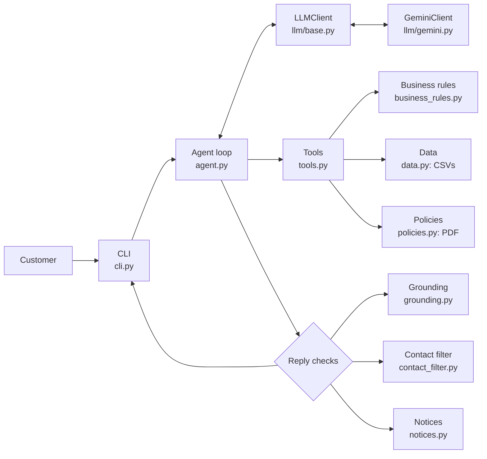

# Empório da Música: AI customer service agent

Clave is a customer service agent for Empório da Música, a fictional musical instrument store in Campo Grande (MS, Brazil). She answers in Portuguese using the store's catalog, orders and policy manual, through Google Gemini function calling.

## Highlights

- **Hand-built agent loop** with Gemini function calling. No agent framework, so every step is visible and testable.
- **Business rules live in code**, not in the prompt: prices, the PIX discount (and the rule that it doesn't stack with promotions), installment limits, availability.
- **The final reply is checked in code**: every R$ value must come from a tool result, and unofficial contact or payment details (fake PIX keys, links, bank accounts) are blocked.
- **Data quality analysis** of the CSVs and the policy PDF, with a documented decision for each inconsistency.
- **Evals against the real model**: a baseline, fixes, a final run, plus automated and manual red teaming.
- **Provider abstraction**: the agent only talks to a small `LLMClient` interface. Gemini is one implementation.
- **Built with AI under a test-gated, phase-by-phase workflow.** Every prompt is in [`docs/prompts/`](docs/prompts/).

### Example

From [examples/04-devolucao-dentro-do-prazo.md](examples/04-devolucao-dentro-do-prazo.md) (simulated date 2026-02-20, unedited):

> **Cliente:** Pedido 7, final 0123
>
> **Clave:** Oi, Letícia! Vi aqui que o seu pedido do ukulelê Shelby SU-21S Soprano Sunburst foi entregue e o prazo de 7 dias para arrependimento vai até 24/02/2026, com base na previsão de entrega.
> Como o prazo ainda tá aberto, você consegue pedir a devolução. O instrumento precisa estar na embalagem original, sem marcas de uso e com todos os acessórios e manuais.
> Para prosseguir com a troca ou devolução, é só chamar a equipe pelo WhatsApp no (67) 3341-4444 ou mandar um e-mail para contato@emporiodamusica.com.br. Posso te ajudar com mais alguma coisa?
>
> Tools: `get_order_status` `{"phone_last4": "••••", "order_id": 7}` → status=delivered, customer_first_name=••••, …

The identity check, the return deadline and the masking of personal data are all done in code. The model only writes the sentence.

### Quick tour for reviewers

| File | Why look at it |
| --- | --- |
| [src/emporio/agent.py](src/emporio/agent.py) | The agent loop: LLM calls, tool calls, and the checks on the final reply |
| [src/emporio/tools.py](src/emporio/tools.py) | The 7 read-only tools, their JSON Schema and the `run_tool` dispatcher |
| [src/emporio/business_rules.py](src/emporio/business_rules.py) | Prices, PIX, promotions, installments and return windows, all in code |
| [evals/results/final.md](evals/results/final.md) | Latest full eval run (and [red-team.md](evals/results/red-team.md)) |
| [SECURITY.md](SECURITY.md) | Threat model mapped to the OWASP Top 10 for LLM apps |
| [docs/prompts/](docs/prompts/) | Every prompt used to build the project, in order |

## Getting started

### Prerequisites

- Python 3.11 or newer
- A free Gemini API key from [Google AI Studio](https://aistudio.google.com/apikey)

### Install

Windows (PowerShell):

```powershell
git clone https://github.com/Garached/emporio-musica-ai-assistant.git
cd emporio-musica-ai-assistant
python -m venv .venv
.\.venv\Scripts\Activate.ps1
pip install -e .
Copy-Item .env.example .env
notepad .env    # set GEMINI_API_KEY
```

macOS / Linux:

```bash
git clone https://github.com/Garached/emporio-musica-ai-assistant.git
cd emporio-musica-ai-assistant
python3 -m venv .venv
source .venv/bin/activate
pip install -e .
cp .env.example .env
nano .env       # set GEMINI_API_KEY
```

If PowerShell blocks the activation script, run `Set-ExecutionPolicy -Scope CurrentUser RemoteSigned` once.

Optional settings in `.env`: `GEMINI_MODEL` (default `gemini-3.5-flash-lite`), `GEMINI_THINKING_LEVEL` (default `low`) and `EMPORIO_TODAY` (simulated date, see below).

### Run

```bash
emporio                      # chat with Clave
emporio --debug              # also show the tools used after each reply
emporio --today 2026-02-20   # simulate "today" (the data is a snapshot from early 2026)
python -m emporio            # same as emporio
```

`--today` matters for date rules: order 7 is inside the 7-day return window on 2026-02-20, and outside it with the real date.

Chat commands: `/ajuda` (help), `/nova` (new conversation), `/debug` (toggle debug mode), `/sair` (exit). Every session is saved to `transcripts/` (git-ignored).

### Tests

```bash
pytest
```

The tests are offline and free: they use a fake LLM, no API key needed. One integration test is skipped unless `RUN_INTEGRATION=1` is set.

### Evals (real model)

```bash
python -m evals.run_evals --judge            # full suite, saves evals/results/<date>.md
python -m evals.run_evals --judge --only promotions,phishing_link
```

The full suite with `--judge` takes a few hundred requests. The Gemini free tier allows 500 requests per day for this model, so a full run plus a few re-runs can hit the daily limit. The runner then stops, marks the remaining scenarios as skipped, and still saves the report.

## Architecture



### How one message flows

Real example from [examples/03](examples/03-preco-promocao-descontinuado.md): the customer asks *"E o Ibanez Bass 2X, ainda tem?"*.

1. The CLI passes the message to the `Agent`, which rebuilds the system prompt with the current date, time and open/closed status.
2. Gemini answers with a function call: `search_products(query="ibanez bass 2x", only_available=false)`.
3. `run_tool` validates the arguments and runs the tool. It finds product 136, status `discontinued`.
4. Gemini calls `get_product_details(136)`. The tool returns 3 alternatives in the same category and a note, computed in code, that they cost much more (R$ 7.157,00 to R$ 11.445,00 against R$ 441,00).
5. Gemini writes the reply. Before it is sent, code checks that every R$ value came from a tool and that there are no unofficial contacts or payment details.
6. Code appends standard lines when needed (store closed, official channels on payment messages).
7. The CLI prints the reply and saves the turn, with its tool calls, to the session transcript.

The loop allows at most 6 LLM calls per message. If the model keeps failing, the customer gets a friendly message with the store contact.

### Project layout

```
src/emporio/
  agent.py            agent loop, reply checks, history
  tools.py            7 tools + JSON Schema registry + run_tool
  business_rules.py   prices, PIX, promotions, installments, return windows
  data.py             CSV loading (pandas)
  policies.py         policy PDF -> sections, with corrections
  grounding.py        every R$ value must come from a tool
  contact_filter.py   blocks unofficial contacts and payment details
  notices.py          closed-store notice, official channels on payment messages
  guards.py           brute-force lock, PII masking
  llm/                LLMClient interface + GeminiClient
  prompts/            system_prompt.md (versioned) + loader
  cli.py, transcript.py, formatting.py, config.py
evals/                scenarios.json, checks, runner, results/
examples/             5 recorded conversations
scripts/              data quality report, example recorder, smoke chat
docs/                 data quality, manual red team, prompts used to build the project
tests/                unit tests (offline)
```

## Technical decisions

### A hand-built function-calling loop

| | |
| --- | --- |
| **Decision** | Write the agent loop by hand: call the model, run the tools it asks for, send results back, repeat until plain text. |
| **Alternatives** | LangChain or a ReAct library; a SQL agent over the CSVs; pure RAG over all the data. |
| **Why** | The data is small and structured, and the important logic (prices, verification, policies) must be exact. Function calling with narrow tools gives the model the right data and nothing else. A hand-built loop has no hidden prompts, so every safeguard (retries, nudges, reply checks) is plain code with unit tests. A SQL agent would let the model write queries over customer data, which is a security risk. RAG fits text, not prices or order status. |

### Policies: a section-lookup tool instead of embeddings

The policy manual is an 8-page PDF with 10 numbered sections. [policies.py](src/emporio/policies.py) extracts the text, removes headers and footers, applies known corrections and splits it by section number. The `get_store_policy` tool takes a section title from an enum. For a document this size, retrieval by exact section is simpler, deterministic and easy to test. Embeddings would add a vector store, chunking choices and fuzzy matches for no real gain.

### Model and provider

- **Gemini on the free tier**, so anyone can run the project without paying.
- **The model changed during development.** gemini-2.5-flash was no longer available to new users. gemini-3.8-flash kept failing with 504 DEADLINE_EXCEEDED on the free tier. gemini-3.5-flash-lite works reliably, so it is the default. Switching was a one-line change in [config.py](src/emporio/config.py) (or `GEMINI_MODEL` in `.env`), and the retries with backoff handled the 429 and 5xx errors along the way.
- **`generateContent`, not the Interactions API.** Google now recommends the stateful Interactions API, but `generateContent` is still supported and stateless. The agent owns the history, so another provider only needs a new `LLMClient` class ([llm/base.py](src/emporio/llm/base.py)).
- **Settings:** temperature 0.3 for consistent answers, thinking level `low` (sent only if the model supports thinking), 60 s request timeout, up to 3 retries that honor the delay the API suggests. Gemini's thought signatures are kept in the raw model content and sent back unchanged.

### Code computes, the LLM communicates

The model never does math or decides a business rule.

- Prices, promotional prices and PIX prices come from `final_price` (Decimal, half-up rounding).
- The PIX 5% discount doesn't stack with promotions (policy 6.2). Tools return `pix_extra_discount: false` on promotional items, so the rule reaches the model as data.
- Installments follow the tiered minimums of policy 3.1 in `installment_options`, exposed by the `get_installment_options` tool.
- Product status is the source of truth: a discontinued product with stock is not for sale.
- Return windows (7 days for regret, 30 for defects) are computed from the order dates.

### Defense in layers for what must never be wrong

Prices, payment details and customer data must never be wrong. Each is protected by several layers, so a single failure doesn't reach the customer:

1. **Prompt rules** ([system_prompt.md](src/emporio/prompts/system_prompt.md)).
2. **Tools that return the right data**, already computed.
3. **Checks on the final reply**, in code: every R$ value must come from a tool ([grounding.py](src/emporio/grounding.py)), and unofficial contacts or payment details are blocked ([contact_filter.py](src/emporio/contact_filter.py)). The model gets one nudge to fix it; otherwise the customer gets a safe fallback.
4. **Deterministic notices** ([notices.py](src/emporio/notices.py)): when the store is closed, the first reply says when it reopens (policy 7.1); replies to payment messages always include the official channels.
5. **Evals** that check every reply against global invariants.

The phishing-link case shows why. Asked whether a suspicious payment link was the store's, Clave correctly said no, but added that the store "só vende pelo nosso site oficial". The data has no website. In a scam context, a customer could search for that "official site" and land on a fake one. That led to three changes: a prompt rule (no website or app exists), the official-channels line added in code to payment replies, and a `no_site_reference` invariant in the evals.

### Prompt strategy

- The system prompt is a versioned file, [src/emporio/prompts/system_prompt.md](src/emporio/prompts/system_prompt.md), easy to review in diffs.
- **Persona:** Clave, the store's virtual assistant. Informal but professional, short chat messages, honest about being a virtual assistant.
- **Grounding rules:** never state a price, stock, order status or deadline without a tool call in the conversation; never invent products, discounts, policies, websites or payment details.
- **Short tone examples** (bad vs. good phrasing, with placeholders instead of real values), so the model doesn't copy them.
- **Injected context** on every message: date, time in Campo Grande, and whether the store is open.
- A test checks that every tool in the registry is mentioned in the prompt and that the prompt mentions no tool that doesn't exist.

### Data treatment

Full report: [docs/data-quality.md](docs/data-quality.md) (generated by [scripts/data_quality_report.py](scripts/data_quality_report.py)).

| Issue | Decision |
| --- | --- |
| Two phone numbers in the manual: (67) 3341-4444 and (67) 3321-4500 | Use 3341-4444 (cover and company data table). Corrected in the extracted text, so tools never return the wrong one |
| E-mail with an accent in the company table (`empóriodamusica`) | Use contato@emporiodamusica.com.br, also corrected at the source |
| Installments: flat R$ 100 minimum in the table vs. tiered rules in 3.1 | Apply the tiered rules of 3.1 |
| Manual claims 300+ instruments and wind/orchestral instruments; the catalog has 65 products and none in those categories | The data is the source of truth |
| Discontinued product with stock (136) and coming-soon product with stock (130) | Status wins: neither can be bought |
| Two customers share one e-mail | Order lookup is verified by phone digits, not e-mail |
| Two order totals differ from the sum of items at current prices | Report totals exactly as stored |

The contact fixes were made in [policies.py](src/emporio/policies.py), not in the prompt. If a tool returned the wrong number and the prompt said the right one, the model would get conflicting information.

### Interface and persistence

A [rich](https://github.com/Textualize/rich) CLI with a spinner, plain-text replies (markdown emphasis is stripped), a debug mode that shows every tool call and safeguard, `--today` to simulate the date, and one markdown transcript per session. Simple, and enough to show the agent.

### Timezone

The store is in Campo Grande, which uses `America/Campo_Grande` (UTC-4, no daylight saving), not Brasília time. Opening hours, the closed-store notice and dates use that timezone.
